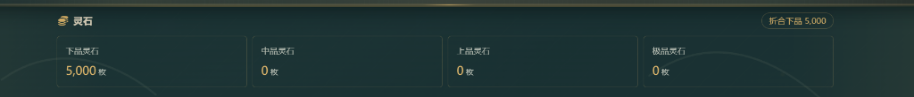
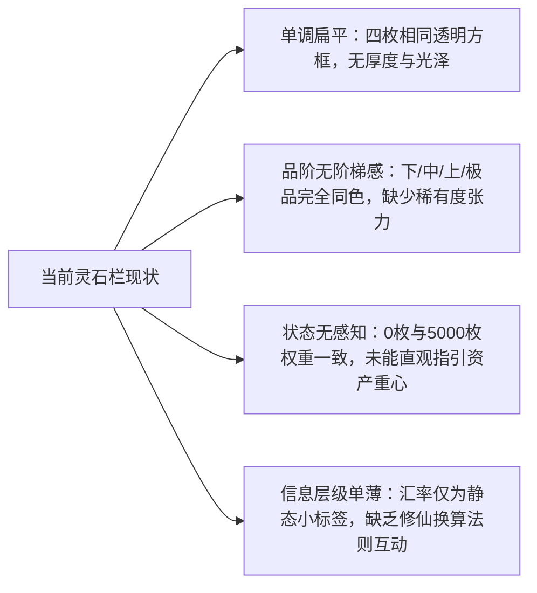

# 储物面板·灵石资产栏视觉重构与美化方案

## 目标简述 (Goal Description)

针对储物面板（`InventoryPanel.vue`）中的「灵石」资产栏（见下附截图），当前样式呈现为单调扁平的线框方盒，缺乏仙侠玄幻氛围、各品阶灵石（下品、中品、上品、极品）无色彩与层级区分、持有与空置状态同质化、折合汇率欠缺交互感。

本方案旨在遵循《灯火阑珊/灯火通明》现有的东方仙侠玄幻美学系统（深青水墨/流光金砂/玉髓微质感），将灵石资产栏重塑为**仙家灵晶玉匣**风格，并同步升华储物面板的整体容器质感。



---

## 现状问题剖析 (Visual Diagnostics)



1. **品阶无色彩分级**：四阶灵石数值皆使用通用淡金色，无法体现从凡俗通行的“下品”到夺天地造化的“极品”之间的质感鸿沟。
2. **卡片结构过于朴素**：仅包含纯文字与数量，缺少仙晶晶簇、符纹铭刻或灵气光晕等图腾修饰。
3. **持有与空匮同质化**：`0 枚` 与有实际余额的卡片视觉同权，空置卡片未作静默收敛，充盈卡片未作灵光流转。
4. **折合标签交互欠缺**：右侧「折合下品 5,000」仅为普通圆角标签，缺乏汇率（1💯100:100）的直观浮层或比率提示。

---

## 视觉重构体系设计 (Design System & Aesthetics)

### 1. 灵石品阶专属色彩与光晕映射 (Grade Tier Spectrum)

依据修仙设定中的天地灵机品序，为四种灵石定制专属材质与光晕色彩（复用全局变量并与主题系统自适应）：

| 灵石品阶           | 灵气意象           | 主调色                                       | 灵晶底色 / 边框流光 | 图标标识                                                | 设定倍率  |
| :----------------- | :----------------- | :------------------------------------------- | :------------------ | :------------------------------------------------------ | :-------- |
| **下品灵石** | 青木初凝，质朴沉敛 | `--jade-soft` / 柔青玉灰 (`#8ca59c`)     | 沉敛青碧，微透雾光  | `fa-solid fa-gem` (初晶)                              | 1 (基准)  |
| **中品灵石** | 碧波凝翠，灵液流转 | `--jade` / 翠灵玉色 (`#48b88d`)          | 润泽翡翠，深青碧晕  | `fa-solid fa-gem` (灵珀)                              | 100       |
| **上品灵石** | 紫霄凝魄，霞蔚精粹 | `--semantic-info` / 紫霄雷晶 (`#9d78f2`) | 幽深紫岚，晶面折射  | `fa-solid fa-diamond` (宝晶)                          | 10,000    |
| **极品灵石** | 纯阳炽金，天地绝巅 | `--gold` / 曜阳天晶 (`#f0b85a`)          | 曜金霞光，灵韵跃动  | `fa-solid fa-crown` / `fa-solid fa-sparkles` (神魄) | 1,000,000 |

### 2. 卡片立体结构（灵晶宝鉴）

```
+-------------------------------------------------------------+
| [图标] 极品灵石                        [百万倍率 / 灵光印]   |
|                                                             |
|       0  枚                                                |
|                                                             |
|  [空匮静敛 / 持有有光]                [品阶折算小计]         |
+-------------------------------------------------------------+
```

- **四角古雅纹饰**：利用 CSS 伪元素绘制微型仙家如意云纹/护角框线，与外部舞台框架（`--frame-overlay`）自然呼应。
- **动态灵光状态**：
  - **充盈状态（数量 > 0）**：边框与阴影泛起专属品阶光晕，数字呈现温润发光质感（`text-shadow: 0 0 12px var(--tier-glow)`），底部有极淡的灵液渐变沉淀。
  - **空匮状态（数量 == 0）**：数字与边框轻微收敛沉底，显示淡雅幽暗的“虚位”，视觉不喧宾夺主，资产一目了然。
- **微交互悬浮**：
  - 鼠标悬停（Hover）时，卡片轻微上浮 2px，专属品阶灵光扩散，展现晶面折射高光。

### 3. 灵石总值折算交互气泡 (Exchange & Valuation)

- 将右上角「折合下品」重塑为**灵算宝玉 (Abacus Seal)** 样式，带有算筹/法盘微图标。
- **悬停浮层（Hover Tooltip）**：展示仙界通用兑换法则：
  $$
  1 \text{ 极品} = 100 \text{ 上品} = 10,000 \text{ 中品} = 1,000,000 \text{ 下品}
  $$

  并可一键展开各品级实际贡献资产百分比分布条（Asset Ratio Bar）。

### 4. 储物面板（法宝/储物戒/杂物袋）整体联动

- 统一各分区标题的古风装饰线（金纹点缀、卷轴印章感）。
- 物品卡片（`item-strip`）的品阶边框色彩与灵石色彩体系完全对齐，避免色调割裂。

---

## 需用户确认的事项 (User Review Required)

> [!IMPORTANT]
> **关于组件改动范围与同步**：
>
> 1. 本次重构的核心文件为 `src/灯火通明-测试版/components/InventoryPanel.vue`。
> 2. 项目中同时存在 `src/灯火通明/components/InventoryPanel.vue`，两份代码当前完全一致。确认修改时是否同步更新测试版与正式版？
> 3. Git 备份机制：执行代码改动前，我将严格执行 `CLAUDE.md` 规则，创建完整的 Git 备份提交。

> [!TIP]
> **关于卡片呈现风格倾向**：
> 方案默认采用**温润仙玉风格（深翠翡翠/紫霄/曜金晶卡）**。如果你倾向于更克制沉稳的冷金水墨风格，或更华丽的流光动态粒子风格，可在此调整预设偏好。

---

## 拟定修改计划 (Proposed Changes)

### 储物面板组件重构

#### [MODIFY] [InventoryPanel.vue](file:///d:/SillyTavern/vscode/Apeiria/src/灯火通明-测试版/components/InventoryPanel.vue)

1. **模板结构增强**：
   - 提取各品阶元数据（图标、倍率标识、中文简称）。
   - 改造 `.spirit-stone-balance` 结构，增加品阶专属类名（`.grade-low`, `.grade-mid`, `.grade-high`, `.grade-supreme`）与状态类名（`.is-empty`, `.has-balance`）。
   - 为折合标签增设汇率提示气泡与微图标。
2. **样式重构 (SCSS)**：
   - 引入各品阶专属 CSS 变量（`--stone-color`, `--stone-glow`, `--stone-bg`）。
   - 实现灵晶卡片的微质感背景渐变与光晕阴影。
   - 实现悬停微动效与暗光聚焦状态。
   - 优化响应式排版（移动端 2×2 网格布局时字号与间距自适应）。
3. **保持逻辑与测试完全兼容**：
   - 保留所有已有的 `data-item-name` 与 `tabindex="-1"` 属性，确保 `focusStageElement` 与外层跳转完全不受影响。

---

## 验证计划 (Verification Plan)

### 自动化测试

运行既有的灵石与资产回归测试，确保数据结构与展示未受任何逻辑破坏：

```powershell
npx tsx tests/spirit-stone.test.ts
```

### 手工与浏览器视觉验证

1. 使用 `chrome-devtools` 连接酒馆网页，切换至「储物」面板查看灵石栏效果。
2. 检查下品、中品、上品、极品四种卡片在持有与为 0 时的色彩表现与对比度。
3. 检查悬浮动效、聚焦轮廓（Focus Ring）以及在小屏幕（移动端 breakpoint ≤ 480px）下的双列自适应布局。
4. 检查与既有主题切换（如不同配色方案）的兼容性。
