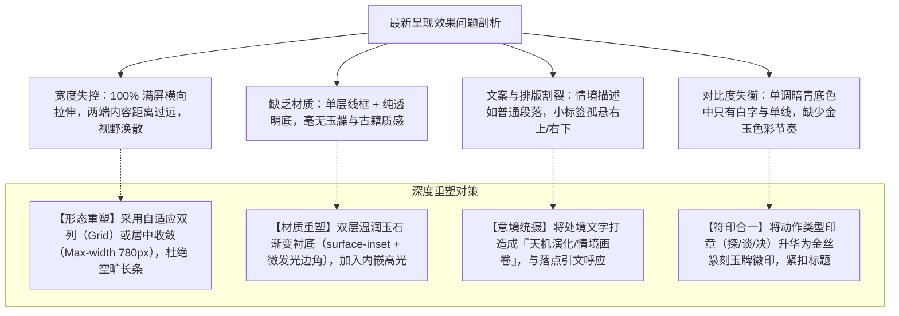

# 行事面板·视觉体系重构与美化润色方案（第二版：令签玉牒与案牍化深度重塑）

## 目标简述 (Goal Description)

在第一轮尝试中，界面将「此刻可为」调整为横向单列，但实际呈现效果（见最新截图）依然存在显著的违和感与审美缺陷：
1. **通栏横向拉伸导致严重视觉空洞**：在桌面端/大屏视口下，卡片直接跨越 100% 容器宽度，左侧是标题与文段，右侧是孤零零贴在最右边缘的小标签，中间存在大片冰冷、空旷的黑色虚空；
2. **生硬线框缺乏仙家材质厚度**：仅靠单层 1px 细线勾出一个巨大的工业几何长方框，缺乏玉简、云宣纸卷或砚石案牍的厚度与光泽；
3. **情境文本与卡片层级断裂**：上方的当前处境叙述（“苓沅于栖霞药谷……”）仅作为散漫的单行文本悬浮在界面中，未与下方的行动抉择形成“案情·推演·决意”的有机闭环；
4. **印章与标题关系脱节**：左侧独立的小方块印标（“谈”、“探”）与标题排布较为生硬，视觉重心不稳。

**本方案目标**：彻底推翻“通栏单行大方框”的平庸思路，借鉴古代**「修仙宗门案牒 · 玉简令签」**的经典意境，通过**宽度收敛约束 / 自适应多列令签网格**、**双层玉石浮雕边框**、**场景情境卷轴化**与**灵动流光微动效**，实现与上方「当前落点」红框标杆的完美融合。

---

## 现状效果不佳的根源剖析 (Visual Diagnostics)



---

## 核心设计理念：从“表单卡片”到“仙门令签” (Core Metaphor Shift)

### 1. 结构形式革新：双列错落 / 宽度收敛令签（Talisman Slips）

不要做满屏单条！人在阅读抉择支时，视线最佳宽度在 `320px ~ 420px` 之间。
* **桌面宽屏**：采用 `grid-template-columns: repeat(auto-fit, minmax(340px, 1fr))` 的自适应令签阵列，使 3 项起念并排或错落排布，宛如悬浮在修仙者眼前的**三枚悬空玉牒**。
* **窄屏/移动端**：自适应切换为单列紧凑令签，宽度自动收敛，杜绝两头空。

```
+-----------------------------------------------------------------------------------+
|                        【情境卷轴 · 灵台观照】                                    |
|   “ 苓沅于栖霞药谷绝壁设网误捕南宫云裳，见其娇小金贵，心怀人愧……伴装摔 ”            |
+-----------------------------------------------------------------------------------+
                                          ↓
   【令签一：商谈·柔声相询】                     【令签二：探查·验伤照拂】
+------------------------------------+    +------------------------------------+
| ❖【谈】老老实实蹲身相背    [交涉] |    | ❖【探】焦急探查脚踝伤损    [探查] |
| ────────────────────────────────── |    | ────────────────────────────────── |
| 心怀歉疚，将藤篓药锄挂在胸前，顺从 |    | 听闻她‘腿软走不得路’，满心焦急，   |
| 地半跪在石台上挽起衣袍，温言相请…… |    | 半蹲下去伸手小心握住红云靴探查……   |
|                                    |    |                                    |
| ✦ 正中小帝姬下怀，最能惹其爱怜护短 |    | ✦ 近身接触或引来小神医羞恼娇嗔……   |
+------------------------------------+    +------------------------------------+
```

### 2. 材质与视觉重塑细节

1. **令签玉牌底板（Jade Plate Material）**：
   * 背景使用双层复合渐变：`linear-gradient(135deg, color-mix(in srgb, var(--jade) 6%, var(--surface-inset)), var(--surface-inset))`。
   * 边框使用带有金碧双色的微光描边：`border: 1px solid color-mix(in srgb, var(--gold) 22%, var(--line-subtle))`。
   * 顶部加入 1px 的极淡流光高光（`box-shadow: inset 0 1px 0 rgba(255, 255, 255, 0.04), 0 4px 16px rgba(0, 0, 0, 0.3)`）。

2. **行动印章与标题浑然一体（Unified Seal Header）**：
   * 将小方块印标提升为精致的**古铜/青玉印戳**，嵌在标题最左侧，与宋体标题（`font-family: 'Songti SC', STSong, serif; font-size: 15px; font-weight: 600; color: var(--text-primary)`）并排齐平。
   * 右侧标签（交涉/探查）使用古典篆标风格，并配上对应行动品阶的灵光色调（交涉·暖金 / 探查·玄碧 / 攻伐·朱赤）。

3. **微动效与沉浸交互（Hover & Focus）**：
   * 鼠标悬停（Hover）在令签上时：卡片轻微上浮 2px，卡片边框泛起淡淡的灵气光晕（`border-color: var(--gold)`），印章微微发光，给玩家以“引动天机灵符”的实质反馈。

4. **情境叙述卷轴化（Situation Vignette）**：
   * 上方那句“当前处境”不应光秃秃丢在一边，应使用类似落点引文的半透明砚台卷轴包装（带有前后古典双引号、左右金丝小边线），作为起念的前置铺垫。

---

## 需用户确认的事项 (User Review Required)

> [!IMPORTANT]
> **关于起念卡片的排版形式（关键决定）**：
> 1. **双列令签网格（强烈推荐）**：如上文示意图所示，宽屏下自动以 2 列或 3 列并排成“玉牒令签”，每一项紧凑充实，彻底消除通栏的巨大空洞感。
> 2. **居中收敛单列（备选）**：如果希望维持单列列表，我们将宽度严格限制在 `max-width: 760px` 并水平居中，两端留出雅致的留白，卡片内重新紧凑编排。

> [!TIP]
> **关于任务与行旅的整体呼应**：
> 本次改进不仅优化「此刻可为」，还会将下方的「任务」和「世闻」同步升级为同等质感的**玉简折页**，确保整个「行事」面板自上而下浑然一体。

---

## 拟定修改计划 (Proposed Changes)

### 模块：`AffairsActions.vue` 彻底重构令签布局

#### [MODIFY] [AffairsActions.vue](file:///d:/SillyTavern/vscode/Apeiria/src/灯火通明-测试版/components/AffairsActions.vue)

* **情境文案卷轴化**：
  * 将 `.situation` 赋予类似 `.brief-desc` 的古卷框体结构：
    ```scss
    .situation {
      text-align: center;
      padding: 12px 20px;
      margin: 14px 0 18px;
      line-height: 1.8;
      color: var(--text-secondary);
      font-size: 13px;
      background: var(--surface-inset);
      border: 1px solid var(--line-subtle);
      border-radius: 6px;
      font-style: normal;
    }
    ```

* **令签卡片自适应网格（Grid）**：
  * 将 `.action-list` 升级为网格容器：
    ```scss
    .action-list {
      display: grid;
      grid-template-columns: repeat(auto-fit, minmax(320px, 1fr));
      gap: 14px;
      margin-top: 14px;
    }
    ```

* **令签卡片内部结构精雕**：
  * 重塑 `.action-card` 与 `.action-choice`：
    ```scss
    .action-choice {
      display: flex;
      flex-direction: column;
      gap: 10px;
      padding: 16px 18px;
      height: 100%;
      background: linear-gradient(135deg, color-mix(in srgb, var(--gold) 3%, var(--surface-inset)), var(--surface-inset));
      border: 1px solid color-mix(in srgb, var(--gold) 20%, var(--line-subtle));
      border-radius: 7px;
      box-shadow: inset 0 1px 0 rgba(255, 255, 255, 0.03), 0 3px 12px rgba(0, 0, 0, 0.2);
      transition: all 0.22s cubic-bezier(0.16, 1, 0.3, 1);

      &:hover:not(:disabled) {
        transform: translateY(-2px);
        border-color: color-mix(in srgb, var(--gold) 50%, var(--line-subtle));
        box-shadow: inset 0 1px 0 rgba(255, 255, 255, 0.06), 0 6px 20px rgba(0, 0, 0, 0.35);
      }
    }
    ```
  * 标题行整合：印章印标（金丝边框微篆字）+ 宋体标题 + 右侧古典篆标。
  * 正文：行高 1.75，字号 13px，阅读顺畅自然。
  * 底部机缘提示（“✦ 正中小帝姬下怀……”）：作为点睛金字收尾。

---

## 验证与验收方案 (Verification Plan)

1. **实时页面比对**：
   * 在浏览器打开 `http://127.0.0.1:8001/`，查看「行事」面板。
   * 观察起念选项在桌面宽屏下是否自然排列为 2~3 列错落有致的“仙家令签”，彻底告别通栏横向拉伸的大空洞。
2. **文本与层级检查**：
   * 检查处境描述是否具有案卷仪式感；
   * 检查印章与标题的配合是否和谐雅致。
3. **交互验证**：
   * 点击选项是否能正确填入行动输入框并发起推演。
